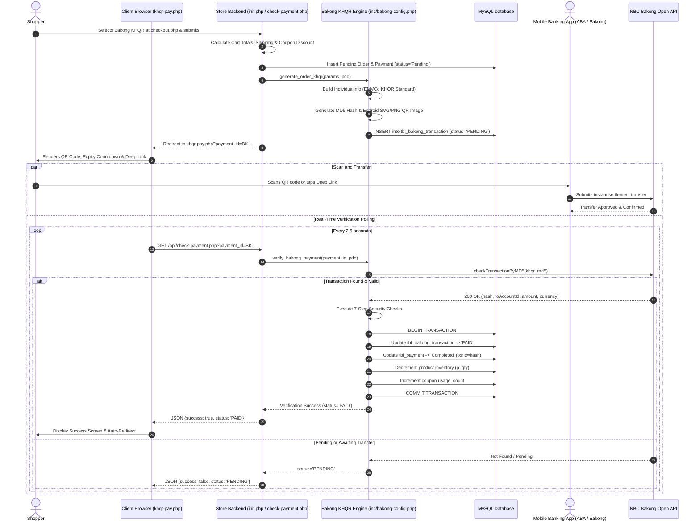
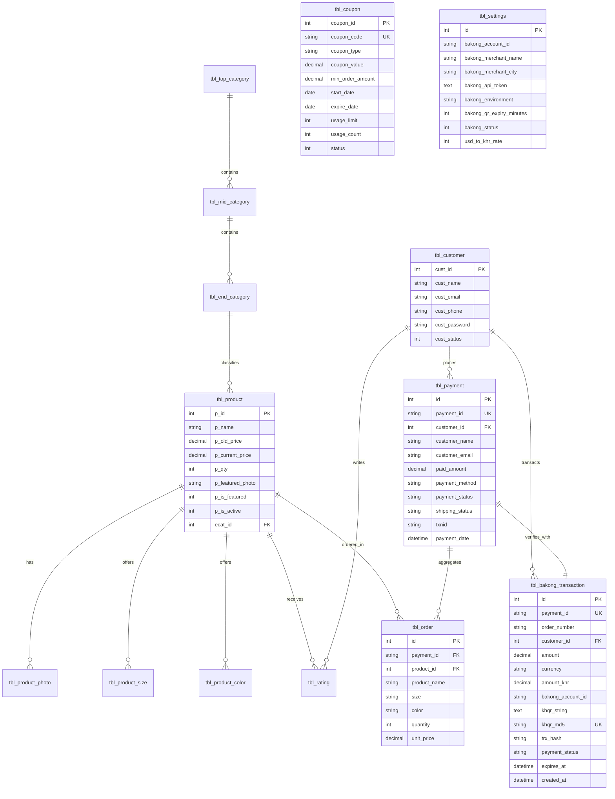

# System Architecture & Technical Specification

> **Project:** eCommerceSite-PHP  
> **Target Environment:** PHP 7.4 / 8.2+ | MySQL / MariaDB  
> **Document Purpose:** Engineering Wiki & Architectural Blueprint  
> **Last Updated:** November 2026  

---

## 1. Executive Summary & System Overview

**eCommerceSite-PHP** is a full-featured, responsive, multi-currency eCommerce platform designed for web retail. The architecture balances traditional **Server-Side Rendered (SSR)** PHP modular components with **modern asynchronous (AJAX/Fetch) micro-endpoints**, delivering an interactive customer experience alongside a robust back-office operations engine.

### Key Architectural Highlights
- **Dual-Portal Segmentation:** Clean separation between the customer-facing storefront and the role-secured administration console (`/admin`).
- **NBC Bakong KHQR Payment Engine:** First-class integration with the National Bank of Cambodia (NBC) Bakong payment system, featuring dynamic EMVCo KHQR generation, real-time client polling, webhook processing, cryptographic MD5 hash validation, and strict anti-replay transaction protection.
- **Dynamic Multi-Currency & Localization:** Dual-currency operations supporting United States Dollars (**USD**) and Cambodian Riels (**KHR**) with live exchange rate calculation and standard Cambodian 100-Riel cash rounding.
- **3-Tier Category Taxonomy:** Flexible product categorization through a normalized `Top Category` &rarr; `Mid Category` &rarr; `End Category` hierarchy.
- **Asynchronous User Experience:** Non-blocking AJAX micro-services for real-time live search suggestions, instant quick-view modals, cart quantity adjustments, wishlist synchronization, and dynamic coupon validation.

---

## 2. Architectural Design Patterns & Principles

```
+---------------------------------------------------------------------------------------+
|                                    CLIENT TIER                                        |
|   Desktop Browser / Mobile Browser / Banking Mobile Apps (Bakong, ABA, Wing, etc.)    |
+-------------------------------------------+-------------------------------------------+
                                            |
                                  HTTPS / Synchronous & AJAX
                                            |
+-------------------------------------------v-------------------------------------------+
|                                 APPLICATION TIER                                      |
|                                                                                       |
|   +------------------------------------+   +--------------------------------------+   |
|   |         Public Storefront          |   |          Admin Back-Office           |   |
|   |  (index, product, cart, checkout)  |   |   (products, orders, reports, etc.)  |   |
|   +-----------------+------------------+   +-------------------+------------------+   |
|                     |                                          |                      |
|   +-----------------v------------------------------------------v------------------+   |
|   |                              API & Micro-Services Layer                       |   |
|   |   (api/check-payment, api/bakong-webhook, api-search, api-quickview, coupon)  |   |
|   +------------------------------------+------------------------------------------+   |
|                                        |                                              |
|   +------------------------------------v------------------------------------------+   |
|   |                           Business Logic & Engines                            |   |
|   |    (inc/bakong-config, admin/inc/functions, CSRF_Protect, Currency Engine)    |   |
|   +------------------------------------+------------------------------------------+   |
|                                        |                                              |
|   +------------------------------------v------------------------------------------+   |
|   |                         Data Access Layer (PDO Engine)                        |   |
|   |           (Prepared Statements, Transaction Control, Error Handling)          |   |
|   +------------------------------------+------------------------------------------+   |
+----------------------------------------|----------------------------------------------+
                                         |
                               MySQL Protocol (TCP / Socket)
                                         |
+----------------------------------------v----------------------------------------------+
|                                  DATA PERSISTENCE TIER                                |
|           MySQL / MariaDB (`ecommerceweb`) - InnoDB Engine, UTF-8 (utf8mb4)          |
+---------------------------------------------------------------------------------------+
```

### Core Architecture Patterns
1. **Layered Component Architecture:** Presentation, logic, data abstraction, and database persistence layers are decoupled to ensure maintainability.
2. **Session-Isolated Authentication:** Separate session state machines for storefront shoppers (`$_SESSION['customer']`) and administrative personnel (`$_SESSION['user']`).
3. **Optimistic Locking & Stock Rollback Daemon:** Automated cleanup mechanism in `header.php` detects abandoned reservations (>24 hours) and restocks inventory via atomic SQL updates.
4. **Defense-in-Depth Security:** Anti-CSRF token verification on state-changing requests, PDO parameterized queries across 100% of database interactions, input sanitization, and server-side authority on all pricing/transaction verifications.

---

## 3. Technology Stack Matrix

| Layer | Component / Tool | Version / Specification | Purpose |
| :--- | :--- | :--- | :--- |
| **Backend Runtime** | PHP | 7.4 / 8.2+ | Server-side execution and page rendering |
| **Database** | MySQL / MariaDB | 5.7+ / 8.0+ / 10.4+ | Relational data persistence (InnoDB engine) |
| **Payment SDK** | `fidele007/bakong-khqr-php` | `^1.2` | EMVCo KHQR generation & Bakong Open API verification |
| **QR Code Engine** | `endroid/qr-code` | `^5.0` | High-fidelity SVG / PNG QR code rendering |
| **Frontend Framework** | Bootstrap | 3.3.7 | Responsive UI grid and modal dialogues |
| **Client Scripting** | JavaScript / jQuery | ES6+ / jQuery 2.2.4 | DOM interaction, AJAX polling, live search |
| **Icons & Media** | FontAwesome / Owl Carousel | 4.7.0 / 2.x | UI iconography and responsive product carousels |
| **UI Components** | Select2, Magnific Popup | Latest | Enhanced dropdowns and modal product lightbox |
| **Dependency Mgr** | Composer & npm | Composer 2.x / npm 9.x | Backend SDKs and Node-based toolchains |

---

## 4. High-Level System Architecture Diagram

```mermaid
flowchart TD
    subgraph Clients["Clients & Users"]
        Customer["Shopper Browser"]
        AdminUser["Store Administrator"]
        BankingApp["Customer Banking App<br/>(Bakong / ABA / Wing)"]
    end

    subgraph Storefront["Customer Storefront (PHP SSR)"]
        Index["Home Page (index.php)"]
        Catalog["Product & Categories (product.php)"]
        Cart["Cart & Coupon (cart.php)"]
        Checkout["Checkout Engine (checkout.php)"]
        KHQRPage["Payment Screen (khqr-pay.php)"]
    end

    subgraph AdminPanel["Administration Console (/admin)"]
        AdminDash["Dashboard & KPIs (index.php)"]
        CatalogMgmt["Products & Categories CRUD"]
        OrderMgmt["Order & Payment Manager (order.php)"]
        Reports["Sales Analytics & CSV (reports.php)"]
        Settings["Store & Bakong Settings (settings.php)"]
    end

    subgraph AsyncAPIs["Async REST / AJAX Micro-Services (/api)"]
        APISearch["api-search.php<br/>(Live Autocomplete)"]
        APIQuickview["api-quickview.php<br/>(Modal Data)"]
        APICheckPay["api/check-payment.php<br/>(Status Poller)"]
        APIWebhook["api/bakong-webhook.php<br/>(IPN Receiver)"]
        APICartQty["api/cart-update-qty.php<br/>(Cart Sync)"]
    end

    subgraph CoreEngines["Core Logic & Payment Engine"]
        BakongEngine["inc/bakong-config.php<br/>(KHQR Gen & Strict Verification)"]
        FuncLib["admin/inc/functions.php<br/>(Formatting, Rates, Card Renderers)"]
        CSRF["admin/inc/CSRF_Protect.php<br/>(Token Guards)"]
    end

    subgraph ExternalGateways["External Services"]
        NBCBakong["NBC Bakong Open API<br/>(api-bakong.nbc.gov.kh)"]
        PayPalGateway["PayPal Payment Gateway"]
    end

    subgraph Persistence["Persistence Layer (MySQL: ecommerceweb)"]
        DB[(MySQL Database<br/>tbl_product, tbl_order,<br/>tbl_payment, tbl_bakong_transaction)]
    end

    Customer --> Index
    Customer --> Catalog
    Customer --> Cart
    Customer --> Checkout
    Customer --> KHQRPage

    Customer -.->|Live Search Query| APISearch
    Customer -.->|Product Modal| APIQuickview
    Customer -.->|Quantity Change| APICartQty
    KHQRPage -.->|Poll Payment (2.5s)| APICheckPay

    AdminUser --> AdminDash
    AdminUser --> CatalogMgmt
    AdminUser --> OrderMgmt
    AdminUser --> Reports
    AdminUser --> Settings

    OrderMgmt -->|Manual Check| BakongEngine
    Checkout -->|Init Order| BakongEngine
    APICheckPay -->|Verify Trx| BakongEngine
    APIWebhook -->|Verify Trx| BakongEngine

    BakongEngine -->|Generate / Query MD5| NBCBakong
    BankingApp -->|Scan & Transfer| NBCBakong
    NBCBakong -.->|Webhook Push| APIWebhook

    Checkout --> PayPalGateway

    BakongEngine --> DB
    OrderMgmt --> DB
    CatalogMgmt --> DB
    Catalog --> DB
    Cart --> DB
    Reports --> DB
```

---

## 5. Directory & File Organization

The repository follows a clear domain-oriented structure:

```
eCommerceSite-PHP/
├── admin/                           # Administration portal
│   ├── inc/                         # Admin dependencies & core helpers
│   │   ├── config.php               # Database connection string (PDO initialization)
│   │   ├── CSRF_Protect.php         # Anti-CSRF session token protection class
│   │   └── functions.php            # Currency formatting, image upload, card renderers
│   ├── color*.php                   # Color attribute management CRUD
│   ├── coupon*.php                  # Promotion code configuration & usage tracker
│   ├── customer*.php                # Customer account management & status toggles
│   ├── order*.php                   # Order lifecycle management
│   ├── order-verify-bakong.php      # On-demand admin verification against Bakong API
│   ├── order-manual-confirm.php     # Manual administrative payment confirmation
│   ├── product*.php                 # Product catalog & photo upload management
│   ├── reports*.php                 # Sales revenue aggregate analytics & CSV export
│   ├── settings.php                 # Bakong credentials, currency rates, SEO configs
│   ├── top/mid/end-category*.php    # 3-tier taxonomy management
│   └── index.php                    # Admin dashboard with summary KPI counters
├── api/                             # Modern JSON micro-service endpoints
│   ├── bakong-webhook.php           # Real-time webhook listener for external IPN
│   ├── cart-update-qty.php          # Dynamic AJAX shopping cart quantity synchronizer
│   ├── check-payment.php            # Real-time Bakong KHQR verification & poller
│   ├── create-order.php             # JSON API for automated order initialization
│   └── test-bakong.php              # Diagnostic connectivity utility for Bakong API
├── assets/                          # Static web assets
│   ├── css/                         # Stylesheets (modern-ecommerce.css, bootstrap)
│   ├── js/                          # Client JavaScript scripts & jQuery libraries
│   └── uploads/                     # File storage for product images, sliders, banners
├── config/                          # Dedicated component configurations
│   └── bakong.php                   # Fallback API endpoint constants
├── database/                        # Database migrations & schemas
│   ├── bakong_migration.sql         # Migration script for tbl_bakong_transaction
│   └── ecommerceweb.sql             # Full database schema export
├── inc/                             # Core shared backend engines
│   └── bakong-config.php            # Bakong KHQR generator, verification & atomic settlements
├── payment/                         # Payment gateway handlers
│   ├── bakong/                      # Bakong KHQR initiation route
│   │   └── init.php                 # Calculates totals, reserves order, generates KHQR
│   ├── bank/                        # Bank wire transfer payment handler
│   │   └── init.php                 # Manual deposit verification workflow
│   └── paypal/                      # PayPal IPN and checkout processor
│       ├── payment_process.php      # PayPal redirect initiator
│       └── verify_process.php       # PayPal IPN confirmation listener
├── api-coupon.php                   # AJAX discount coupon validation endpoint
├── api-quickview.php                # AJAX quick product preview modal service
├── api-search.php                   # AJAX real-time predictive product search
├── api-wishlist.php                 # AJAX session & persistent wishlist manager
├── cart.php                         # Shopping cart viewer & calculation page
├── checkout.php                     # Multi-step checkout & payment selector
├── currency-switch.php              # Session currency (USD/KHR) & language switcher
├── header.php                       # Global page header & stale-order garbage collector
├── index.php                        # Customer storefront landing page
├── khqr-pay.php                     # Real-time Bakong KHQR presentation & polling UI
└── product.php                      # Product detail view, reviews, and attribute picker
```

---

## 6. Core Subsystems & Components

### 6.1 Storefront & Product Catalog
- **3-Tier Taxonomy:** Organizes products into `Top Category` (e.g., Men, Women, Electronics), `Mid Category` (e.g., Clothing, Footwear), and `End Category` (e.g., T-Shirts, Sneakers).
- **Product Entity Matrix:** Supports multi-variant configurations (sizes in `tbl_size`, colors in `tbl_color`), multiple gallery images in `tbl_product_photo`, customer reviews and star ratings in `tbl_rating`.
- **Live Search (`api-search.php`):** Implements server-side debounced search matching against title, short description, and category names, scoped by active top-categories.
- **Dynamic Quick View (`api-quickview.php`):** Returns lightweight HTML snippets containing product image galleries, live price calculations, stock statuses, and size/color selectors directly into the DOM modal.

### 6.2 Shopping Cart & Promotion Engine
- **Session-Centric Cart:** Tracks product IDs, selected sizes, colors, and quantities in structured session arrays.
- **Coupon Validation System (`api-coupon.php` & `tbl_coupon`):**
  - Supports **percentage-based** and **fixed-amount** discounts.
  - Enforces minimum order amount conditions (`min_order_amount`).
  - Enforces validity periods (`start_date`, `expire_date`) and total usage limits (`usage_limit`).
  - Protects against duplicate applications per session.
- **Dynamic Shipping Computation:** Calculates shipping fees based on the customer's selected destination country (`tbl_shipping_cost`) with fallback to global default rates (`tbl_shipping_cost_all`).

### 6.3 Customer Portal & Order Management
- **Registration & Verification:** Secure customer account creation with activation tokens.
- **Address Book Management:** Dedicated management for separate billing and shipping addresses with automatic pre-population at checkout.
- **Wishlist Engine:** Real-time wishlist toggling stored in session memory for guest shoppers and persisted across navigation.
- **Customer Order History:** Visual order listing showing payment status (`Pending`, `Completed`), shipping status, transaction reference hashes, and product breakdowns.

### 6.4 Back-Office Operations & Analytics
- **Order Management Console (`admin/order.php`):** Real-time monitoring of all orders across all payment methods. Features single-click status transitions and direct verification for Bakong payments.
- **Sales Analytics Engine (`admin/reports.php`):**
  - Real-time aggregations of gross revenue, completed orders, and units sold.
  - Date filtering: Today, Last 7 Days, Month-to-Date, Year-to-Date, and custom date ranges.
  - Top-performing products table with quantity and revenue totals.
  - One-click CSV reporting export (`admin/reports-csv.php`).
- **Dynamic Settings (`admin/settings.php`):** Allows administrative configuration of the Bakong merchant ID, API Bearer token, environment toggle (`sandbox` vs `production`), QR expiration minutes, and the live USD-to-KHR exchange rate.

---

## 7. Bakong KHQR Payment Engine Deep-Dive

The NBC Bakong KHQR integration is built to enterprise financial standards, enforcing an end-to-end zero-trust verification pipeline.

### Payment Sequence Workflow



### The 7-Step Security Validation Pipeline
When verifying a transaction via `verify_bakong_payment()` (triggered by the AJAX poller, the incoming webhook, or the manual admin button), the engine executes seven strict, non-bypassable checks:

1. **Expiration Boundary Check:** Verifies current server timestamp against `tbl_bakong_transaction.expires_at`. Transactions exceeding the configurable window (default 15 minutes) are flagged as `EXPIRED`.
2. **Cryptographic MD5 Query:** Connects securely to the NBC Bakong API endpoint (`https://api-bakong.nbc.gov.kh` or SIT sandbox) using the configured Bearer token to fetch transaction details by the EMVCo MD5 hash.
3. **Destination Account Integrity:** Ensures `data.toAccountId` exactly matches the store's registered Bakong Account ID (e.g., `rathanychoeur@bkrt`), preventing payment diversion attacks.
4. **Currency Integrity Validation:** Asserts that `data.currency` matches the order's billed currency (`USD` or `KHR`). Cross-currency substitutions are rejected.
5. **Exact Amount Verification:** Compares `data.amount` against expected order total with a floating-point epsilon tolerance ($< 0.009$). Partial or insufficient payments fail immediately.
6. **Anti-Replay Hash Uniqueness:** Queries `tbl_bakong_transaction` for the NBC transaction `hash`. If the hash exists on any other order, execution is aborted to prevent transaction reuse attacks.
7. **Atomic Database Settlement:** Wrapped in a database transaction (`beginTransaction` / `commit`):
   - Updates `tbl_bakong_transaction.payment_status = 'PAID'` and stores the raw NBC response payload.
   - Updates `tbl_payment.payment_status = 'Completed'` and sets `txnid = hash`.
   - Decrements physical stock in `tbl_product` using `GREATEST(0, p_qty - qty)`.
   - Increments coupon redemption counter in `tbl_coupon`.
   - Clears the active shopping cart session.

---

## 8. Database Architecture & Schema (ERD)

The system relies on an indexed, relational MySQL database named `ecommerceweb`.



### Key Relational Rules & Indexes
- **`tbl_bakong_transaction.payment_id`**: Unique Index (`idx_payment_id`) mapping 1:1 to `tbl_payment.payment_id`.
- **`tbl_bakong_transaction.khqr_md5`**: Unique Index (`idx_khqr_md5`) enabling $O(1)$ fast lookups during high-frequency polling.
- **`tbl_bakong_transaction.trx_hash`**: Standard Index (`idx_trx_hash`) enabling fast anti-replay verification across completed payments.
- **`tbl_order.payment_id`**: Foreign Key referencing `tbl_payment.payment_id`, capturing line items associated with an individual transaction.

---

## 9. Security, Authentication & Session Model

```
+-------------------------------------------------------------------------------+
|                             SECURITY ARCHITECTURE                             |
+-------------------------------------------------------------------------------+
|  1. Injection Defense: 100% Prepared Statements via PDO (zero raw queries)    |
|  2. Cross-Site Scripting (XSS): Output escaping via htmlspecialchars()        |
|  3. Cross-Site Request Forgery (CSRF): Managed via CSRF_Protect class tokens  |
|  4. Privilege Separation:                                                     |
|     - Storefront Session: $_SESSION['customer']                               |
|     - Administrator Session: $_SESSION['user']                                |
|  5. Transaction Integrity: Double-check verification via NBC upstream API    |
|  6. Database Concurrency: ACID transactions with rollback on failure          |
|  7. Automated Maintenance: Stale pending order purging after 24 hours         |
+-------------------------------------------------------------------------------+
```

### Stale Order Garbage Collector
To prevent uncompleted orders from permanently locking up product inventory, `header.php` executes an automated maintenance check on application boot:
- Identifies records in `tbl_payment` where `payment_status = 'Pending'` and `payment_date < NOW() - 24 hours`.
- Reads all associated line items from `tbl_order`.
- Restores original item quantities back into `tbl_product.p_qty`.
- Deletes expired records from `tbl_order` and `tbl_payment`.

---

## 10. Operational & Deployment Guide

### System Requirements
- **Web Server:** Apache 2.4+ (with `mod_rewrite` enabled) or Nginx with `php-fpm`.
- **PHP Version:** PHP 7.4, 8.0, 8.1, or 8.2+ (Recommended: PHP 8.2).
- **Mandatory PHP Extensions:** `pdo_mysql`, `curl`, `json`, `mbstring`, `openssl`, `gd` (or native SVG fallback).
- **Database Engine:** MySQL 5.7+ / MariaDB 10.3+ with InnoDB support.

### Production Configuration Files
1. **Database Configuration:** Located at `admin/inc/config.php`.
   ```php
   $dbhost = 'localhost';
   $dbname = 'ecommerceweb';
   $dbuser = 'your_production_user';
   $dbpass = 'your_production_password';
   define("BASE_URL", "https://yourdomain.com/");
   define("ADMIN_URL", BASE_URL . "admin/");
   ```
2. **Bakong Settings:** Configured via the Admin Panel UI under **Settings &rarr; Bakong KHQR Settings**, or initialized in `tbl_settings`:
   - **Account ID:** `rathanychoeur@bkrt` (or your merchant account).
   - **Environment:** `production` (Live NBC network) or `sandbox` (SIT testbed).
   - **USD to KHR Rate:** Recommended default `4100`.
   - **QR Expiry:** Recommended default `15` minutes.

---

## 11. Maintenance & Troubleshooting Runbook

| Symptom | Root Cause | Remediation Procedure |
| :--- | :--- | :--- |
| **Bakong QR not rendering** | Missing Composer dependencies or GD extension disabled | Run `composer install` in project root. If GD is missing, `inc/bakong-config.php` automatically falls back to clean SVG rendering. |
| **Payment stays 'PENDING' after scan** | Expired / Invalid Bakong API Token | Log in to **Admin &rarr; Settings** and paste a refreshed NBC API Token. Check transaction using **Orders &rarr; Check Bakong Status**. |
| **Admin reports wrong exchange rate** | Outdated rate stored in `tbl_settings` | Update the `usd_to_khr_rate` field under Admin Settings (defaults to 4100 KHR per 1 USD). |
| **Customer cannot checkout** | Stale or empty session data | Verify PHP session write permissions in `/tmp` or `session.save_path`. Check if user is logged into customer account. |
| **Order stuck in manual review** | Network failure between server and NBC | Open **Admin &rarr; Orders &rarr; Actions**, inspect payment ID, and click **Manual Confirm** if funds are verified in bank portal. |
